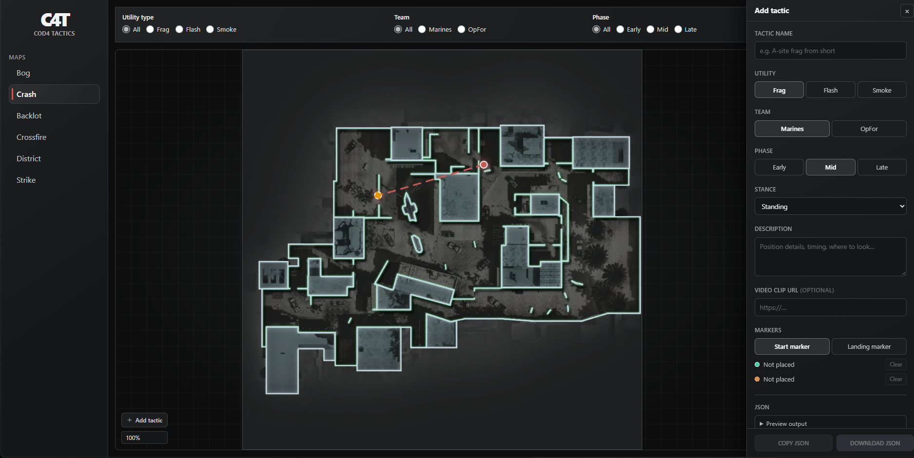
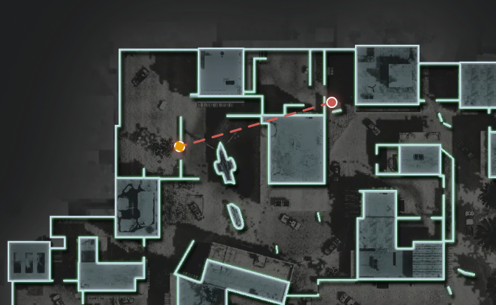

# Contributing to COD4 Tactics

First off, thanks for wanting to add tactics! This project is only as good
as the lineups the community shares. Everything you need to contribute is in
this short guide.

## Table of contents

1. [Adding a new tactic (recommended workflow)](#adding-a-new-tactic)
2. [Manual JSON workflow](#manual-json-workflow)
3. [Tactic schema reference](#tactic-schema-reference)
4. [Quality guidelines](#quality-guidelines)
5. [Local development setup](#local-development-setup)
6. [Submitting the pull request](#submitting-the-pull-request)

## Adding a new tactic

The app ships with a built-in editor so you never have to hand-craft
coordinates or edit JSON files by trial and error. The whole flow takes a few
minutes.

### 1. Open the site and pick your map

Use the **Maps** panel on the left and select the map your tactic belongs to
(crash, backlot, crossfire, district, bog or strike).

### 2. Open the editor

Click **Add tactic** at the bottom-left of the map viewport. A sidebar opens
on the right with the submission form.



### 3. Fill in the tactic details

| Field | What it means |
| --- | --- |
| Tactic name | A short, descriptive title (see [naming guidelines](#quality-guidelines)) |
| Utility | Frag, Flash or Smoke |
| Team | Marines or OpFor |
| Phase | Early, Mid or Late — roughly when in the round you throw this |
| Stance | Standing, Crouch, Walk or Jump (set to None if it doesn't matter) |
| Description | Optional: timing cues, where to look, common mistakes |
| Video clip URL | Optional link to a clip demonstrating the tactic |

### 4. Place the markers on the map

- Select **Start marker** or **Landing marker** in the *Markers* section
  (it auto-advances after you place the first one).
- Click on the map where the player **stands** — a teal dot marks the start.
- Click on the map where the nade **lands** — an orange dashed ring marks the
  landing point.
- Both markers support **zooming**: zoom in first, then click, for precise
  positions. Drag to pan still works while editing; only a plain click
  places a marker.
- Landing is optional (a tactic can exist without it), but for frags, flashes
  and smokes it is highly recommended — the dotted trajectory line between
  start and landing is what makes lineups readable.
- Each marker has a **Clear** button if you need to redo it.



### 5. Copy the JSON

Once the tactic has a name and a start position, the **Copy JSON** /
**Download JSON** buttons in the sidebar footer become enabled:

- **Copy JSON** puts the tactic text on your clipboard — fastest for editing
  the file directly on GitHub.
- **Download JSON** gives you a `<id>.json` file (same content) if you
  prefer working locally.

Use the collapsible **Preview output** section to check the result first.

## Manual JSON workflow

Prefer to skip the editor? You can add tactics directly, but the editor is
strongly recommended: it guarantees coordinates line up with the map the
viewer actually renders.

Tactics live in `public/tactics/<map>_tactics.json`, one file per map:

```
public/tactics
├── backlot_tactics.json
├── bog_tactics.json
├── crash_tactics.json
├── crossfire_tactics.json
├── district_tactics.json
└── strike_tactics.json
```

Each file holds a single `tactics` array:

```json
{
  "map": "crash",
  "tactics": [
    {
      "id": "crash-frag-9svr",
      "map": "crash",
      "name": "crash early nade",
      "utility": "frag",
      "team": "marines",
      "phase": "early",
      "stance": "standing",
      "description": "",
      "videoUrl": null,
      "start": { "x": 60.4, "y": 28.7 },
      "landing": { "x": 34.0, "y": 36.4 }
    }
  ]
}
```

To add one manually: append a new object as the **last element** of the
`tactics` array, paste the JSON you copied from the editor as-is, and keep
everything else untouched.

> **Tip:** appending at the end keeps merge conflicts tiny when several
> people contribute in the same file.

## Tactic schema reference

| Field | Type | Required | Allowed values / format |
| --- | --- | --- | --- |
| `id` | string | yes | Auto-generated by the editor (`<map>-<utility>-<4 chars>`). Keep it as copied. |
| `map` | string | yes | One of `backlot`, `bog`, `crash`, `crossfire`, `district`, `strike` — must match the file |
| `name` | string | yes | Free text, shown on the map and in the breakdown panel |
| `utility` | string | yes | `frag`, `flash` or `smoke` |
| `team` | string | yes | `marines` or `opfor` |
| `phase` | string | yes | `early`, `mid` or `late` |
| `stance` | string \| null | yes | `standing`, `crouch`, `walk`, `jump` or `null` |
| `description` | string | yes | Free text (can be empty `""`) |
| `videoUrl` | string \| null | yes | `https://…` or `null` |
| `start` | object | yes | `{ "x": 0–100, "y": 0–100 }` — percentages of the map frame, where the player stands |
| `landing` | object \| null | yes | Same format, where the nade lands. `null` if not applicable |

Notes:

- Coordinates are **percentages relative to the map frame**, which is exactly
  what the editor measures — this is why we ask you to use it.
- Entries that don't satisfy the allowed values are silently skipped by the
  viewer, so a typo means your tactic simply won't show up. Double-check
  field names and values when writing JSON by hand.
- `tactics` arrays may legitimately be empty (`[]`) — if your favorite map has
  no file yet, create `<map>_tactics.json` following the shape above.

## Quality guidelines

- **Verify before sharing.** Only submit tactics you have personally tested.
  If you can't verify a lineup right now, note it in the description ("untested,
  taken from …"). Honest labelling beats broken content.
- **Name tactics after geometry, not players.** Good: `A-site frag from short`,
  `Mid smoke for rotator delay`. Avoid nicknames that only make sense to you.
- **One tactic = one entry.** Don't bundle several throws into a single entry.
- **Don't edit other entries** while adding yours — keeps diffs minimal and
  review fast.
- **Describe the throw**, not just the position: timing (after first contact,
  five seconds in), stance, and where to visually aim help enormously.
- **Video links must be viewable publicly** (YouTube unlisted or public,
  watchable in a browser without login) — private clips can't be verified.

## Local development setup

You don't need a running server to contribute a tactic (GitHub's web editor
works fine), but it helps if you want to preview your change:

```bash
# Clone the repository
git clone https://github.com/your-username/cod4-tactics.git
cd cod4-tactics

# Install dependencies (Node.js 20+ and npm 11 recommended)
npm install

# Start the dev server
npm start
```

Then open http://localhost:4200 — your tactic should appear on the map
immediately (filters default to showing everything). If it doesn't, the
"no tactics" card in the viewer usually tells you what went wrong.

For contributors working on the app itself:

```bash
npm run build   # production build
npm test        # unit tests (Vitest)
```

Tests run against stubbed tactic data; they don't touch the real JSON files.

## Submitting the pull request

1. **Fork** the repository and create a branch, e.g.
   `tactics/crash-early-nade`.
2. **Add or edit** the relevant `public/tactics/<map>_tactics.json` file.
   Create the file if your map doesn't have one yet.
3. **Validate** your edit either by opening the dev server, or by pasting the
   whole file into any JSON validator (the file must be valid JSON, no
   trailing commas).
4. **Open the PR** with:
   - A short title, e.g. `Add crash early frag lineup`
   - Screenshots or clip links showing the throw in-game (if available)
   - Note any caveats (exact timing requirements, launched from a crouch, …)

A maintainer or a reviewer will load your entry, sanity-check the position on
the map, and merge.

## Cutting a release (maintainers)

Releases are automated through `scripts/release.mjs`:

```bash
# Preview the whole release pipeline without touching anything
npm run release -- patch --dry-run

# Do the real thing
npm run release -- patch        # or minor / major
```

The script will:

1. Verify the working tree is clean (abort otherwise)
2. Run the test suite
3. Bump `package.json` and `package-lock.json` to the next version
4. Fold the `CHANGELOG.md` `[Unreleased]` section into a dated one
   (`## [Unreleased]` becomes `## [x.y.z] - <date>`)
5. Commit (`chore(release): x.y.z`), create the annotated `vx.y.z` tag and
   push both with `git push --follow-tags`

The `v*` tag push is what triggers the "Deploy to Netlify on Release Tag"
workflow, which builds the production bundle and ships it to Netlify — so
once the script finishes, watch the Actions run for the deploy result.

Before releasing: make sure the version-relevant content actually lives
under `CHANGELOG.md`'s `[Unreleased]` heading. Entries added under other
sections are not folded.

---

Thanks for contributing to keeping COD4 competitive! 🎯
