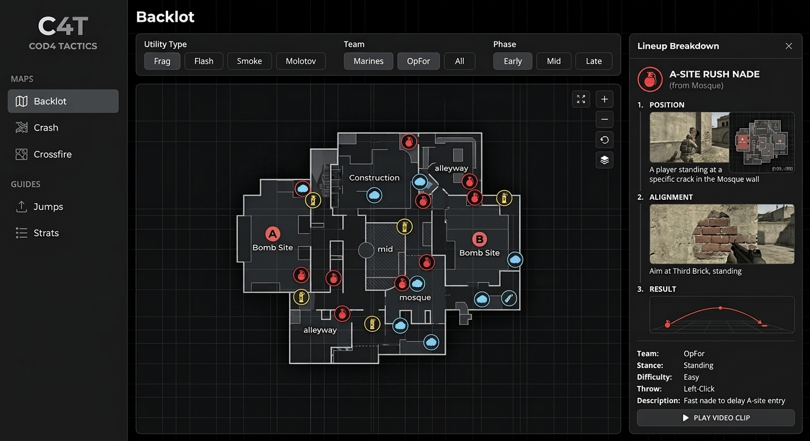

# COD4 Tactics (CoD4 Interactive Map & Utility Guide)

An interactive, high-performance web tool built with Angular for **Call of Duty 4: Modern Warfare (2007)**. Designed to visualize top-down tactical map layouts, precise grenade lineups (frags, flashes, smokes), and strafe jump locations for competitive and casual players alike.




## 📸 Overview

Unlike modern FPS titles, COD4 never had an interactive web-based utility app. **COD4 Tactics** solves this by delivering an interactive canvas overlay where players can:
- Explore high-resolution top-down map layouts (*Crash, Backlot, Crossfire, District, Strike*).
- Filter lineups by **Utility Type** (Frag, Flash, Smoke), **Faction** (Marines / OpFor), or **Difficulty**.
- View crosshair alignments, standing/crouch instructions, and trajectory outcomes.
- Learn classic COD4 strafe jumps and bounce spots with visual guides.


## 🛠️ Tech Stack

- **Framework:** Angular (Signals, Standalone Components, RxJS)
- **Styling:** Tailwind CSS (Dark / High-Contrast Monochrome Theme)
- **Map Rendering:** Interactive SVG / HTML Canvas overlay
- **Media Hosting:** Embedded WebP images / MP4 micro-clips
- **Deployment:** Netlify


## 🚀 Contributing

```bash
# Clone the repository
git clone [https://github.com/your-username/cod4-tactics.git](https://github.com/your-username/cod4-tactics.git)

# Navigate to directory
cd cod4-tactics

# Install dependencies
pnpm install

# Start development server
pnpm start

Navigate to http://localhost:4200/
```


